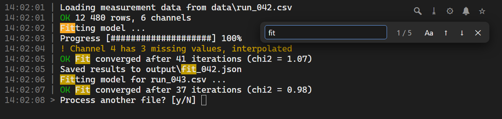

<div align="center">


# PyApp-Template

**Ship a Python script or GUI as a real Windows app: shortcuts, an icon, crash reports and a pinned Python, without compiling anything.**


</div>

You write `main.py` and list your packages. PyApp-Template gives the people using it a folder with
double-clickable shortcuts that carry your app's name and icon. On first start, [uv](https://docs.astral.sh/uv/)
provides the exact Python and locked package versions you chose, and uv installs itself if it is
missing. The people using your app need no Python knowledge: nobody installs Python, activates an
environment or types a command. Everything a script usually lacks comes with it: log files, readable
crash reports instead of a vanishing window, a Stop button, one clean taskbar entry, and a terminal
that can run in a browser tab.

- [Why PyApp-Template](#why-pyapp-template)
- [Quick start](#quick-start)
- [Building your app](#building-your-app)
- [The browser terminal](#the-browser-terminal)
- [Shipping your app](#shipping-your-app)
- [Reference](#reference): shortcuts, settings, logs, dev tools, what it changes on your PC, troubleshooting
- [How it works](#how-it-works)

## Why PyApp-Template

There are three usual ways to give a Python program to someone else. Each leaves a gap that
PyApp-Template is built to close.

| | Run the script<br><sub>`python main.py`, `uv run`</sub> | Freeze it into an `.exe`<br><sub>PyInstaller, Nuitka, cx_Freeze</sub> | **PyApp-Template** |
| --- | --- | --- | --- |
| **What users must know or do** | Install Python and the packages, then use a terminal | Nothing: double-click the `.exe` | Nothing: double-click Setup once, then a shortcut; uv, Python and packages install themselves |
| **Python on the target PC** | Must be installed and on PATH | Bundled | Provided automatically, or bundled for offline use |
| **Admin rights** | Not needed for a per-user Python, but company PCs often block installers | Not needed, unless an installer is used | Never needed: uv, Python and packages install for the current Windows user only |
| **Same packages everywhere** | Only if you manage it | Frozen at build time | Locked in `uv.lock`, installed exactly |
| **Disk space for several apps** | Shared Python, but package versions can clash | Every app carries its own copy of Python and its packages: from about 10 MB to several hundred MB each | One Python and uv's package cache shared by all apps, while each keeps its own locked versions; fully self-contained only if you choose to |
| **After changing the code** | Restart | Rebuild, then redistribute | Restart |
| **Changing Python or packages** | By hand, on every PC | Rebuild, then redistribute | Change a setting; every PC follows on its next start |
| **Shipping an update** | Users copy new files and update packages themselves | Send a new `.exe` to everyone | `git pull` or copy the changed files; new packages install on the next start |
| **Sharing through Git** | Write your own `.gitignore`; a committed `.venv` breaks on other PCs, so everyone rebuilds it by hand | The `.exe` and build folders do not belong in Git; share it as a release download | Ready: `.gitignore` keeps environments, Python and machine-specific files out and the lock file in; recipients just run Setup |
| **Licenses of what you share** | Only your own, if you add one | The `.exe` bundles Python and every package; their license texts are yours to collect and ship | Set up: `LICENSE.md` with a placeholder for yours and the launcher's MIT terms; a Git share bundles no third-party code, and a self-contained folder keeps each package's license files |
| **Build step and its surprises** | None | Hidden imports, data files, DLLs to configure | None |
| **Multiprocessing, subprocesses** | Work as usual | Need `freeze_support()`; `sys.executable` is the app, not Python | Work as usual: it is a normal Python environment |
| **Antivirus warnings** | Rare | Common for small or unsigned builds | Rare: plain Python files and the official interpreter |
| **Start-up time** | Fast | Slow for one-file builds (unpacked on every start) | Fast after the first run |
| **How people start it** | A command or a `.py` file | The `.exe` | Shortcuts in the folder, Start Menu or desktop |
| **Settings for the people using it** | Edit the code, or write your own config file and loader | Write your own config file, loader and a way to find it | `code/settings.py`, opened by the *(Settings)* shortcut; your code reads it with `import settings` |
| **Name, icon, taskbar group** | Python's or the terminal's | Name and icon | Yours, in every window and on the taskbar; every icon size made from one image, crisp down to 16 px |
| **Pinned to the taskbar** | The running app often does not join its pin: a console app joins Windows Terminal's button, and a GUI started through `cmd` gets a button of its own. A shortcut to a `.bat` cannot be pinned | A GUI joins its pin; a console app joins Windows Terminal's button | The running app joins its pin, console included, and stays there after a crash; each start shortcut can be pinned on its own |
| **Console window or not** | With one: an extra window for every app, cluttering the taskbar and easy to close by accident. Without (`pythonw`): prints and errors are lost | The same choice, fixed at build time; without a console, errors show in a bare dialog, if at all | Both, as separate shortcuts. Without a console, prints still go to a log, and a window opens only when the app fails |
| **When it crashes** | The window may vanish with the error | The window vanishes | It stays open with a readable report and a crash log |
| **Tracebacks** | Full, with source lines | Often without source lines | Full, colored, with source lines; file paths are clickable in the browser terminal |
| **Missing package** | `ModuleNotFoundError` | Rebuild | Offers to install it and restart |
| **Started twice / stopping** | Runs twice; Ctrl+C or close | Runs twice; close | Allow, focus, prevent, replace or ask; Stop ends the whole process tree |
| **Users can read and fix the code** | Yes | No | Yes, it is plain source |

**Choose a different tool when** you must hide your source code, need a single file, or target macOS
or Linux: then freeze it, or package it with [Briefcase](https://briefcase.readthedocs.io/). For a
command-line tool for other developers, `uv tool install` or `pipx` is simpler. PyApp-Template is for
the case in between: a Windows app for people who should not need to know it is Python, built by
someone who wants to keep working on the code.

### For you, building the app

**No build step.** Your code runs as plain Python, so there are no hidden imports, data files or
DLLs to configure, and a change needs only a restart. Your editor, debugger and tools work as usual.

**Python and packages are settings.** Name the Python version and the packages in
`developer_settings.py`; `uv.lock` pins the exact versions and every PC installs them on its next
start. A change of Python version can be undone, and the new environment replaces the old one only
once it works.

**Errors you can read.** Tracebacks are colored, show the failing lines of your code with context,
hide the launcher's own frames, and include chained exceptions, notes and exception groups. Hard
interpreter crashes, `sys.exit(1)` and errors in worker threads are reported too.

**Logs that catch everything.** Each run writes a log with your prints and inputs, including the
output of native code and child processes; after a hard crash, the raw output of its last moments
is kept as well.

**Ready to share.** `.gitignore` keeps environments and machine-specific files out of Git, the
license files are set up, and updates reach users through `git pull` or copied files. Updating the
template itself means replacing one folder.

### For the people using it

**Nothing to install or know.** They run Setup once, then double-click a shortcut. uv, Python and
the packages install themselves, for their Windows user only, without admin rights.

**A real app.** Shortcuts in the folder and the Start Menu, and one taskbar entry with your app's
name and icon. A script started from a batch file can leave the taskbar with a batch window, a
Python console and your app, all with default names and icons.

<p align="center">
  
</p>

**No console, no lost errors.** The *(No-Terminal)* shortcut, for GUI apps, shows no console while
the app runs, and everything it prints still goes to the log. If the app fails, a window opens with
the full error and a crash log is written. If it ends normally, nothing appears.

**No vanishing windows.** After a crash, the window stays open with a readable report, and the
*(STOP)* shortcut ends every running instance.

**A terminal in the browser, if they like.** See [the browser terminal](#the-browser-terminal): sharp
text, search, saving the output, clickable file paths and notifications, with the same real console
underneath.

**Settings without touching the code.** Put the options people may change in `code/settings.py`,
with a comment for each. The *(Settings)* shortcut opens that file in VS Code or Notepad, and your
app reads the values with `import settings` on its next start. Prefer another format, such as JSON
or TOML? Point `user_settings_path` at that file and the shortcut opens it instead.

## Quick start

**You need:** Windows 11 (x64) and an internet connection for the first setup. Python is not required.
Windows 10 should work too (the browser terminal needs version 1809 or newer), but it is not tested yet.

1. Clone or [download](../../archive/refs/heads/main.zip) this repository. Windows may ask before running downloaded scripts ([see troubleshooting](#troubleshooting)).
2. Optional: set `program_name` and `python_version` in `code/pyapp/developer_settings.py`.
3. Run **`Setup - run first and after moving folder.cmd`**.
4. Start the example app with the new **PyApp-Template** shortcut (it is named after `program_name`).
5. Replace `code/main.py` with your own code.

Setup creates the shortcuts in the project folder and the Start Menu. **Run it again after moving or
renaming the folder**, and pin the new shortcut if you had pinned the old one. The Python
environment adapts to a new location by itself.

## Building your app

You normally edit three files:

| File | Purpose |
| --- | --- |
| `code/main.py` | Your application |
| `code/pyapp/developer_settings.py` | Name, Python, packages, logging and behavior. Sorted from important to rarely needed; every setting is explained in it. |
| `code/settings.py` | Optional settings for the people using your app. Read them with `import settings`; the *(Settings)* shortcut opens this file. |

### Packages

List them in `developer_settings.py`; the next start installs them:

```python
packages = """
requests
numpy>=2
pillow==11.*
"""
```

The block accepts what a `requirements.txt` accepts. Instead of editing it by hand you can:

- run `code/pyapp/dev_tools/add_packages.cmd` to add packages by name,
- run `find_imports.cmd` to scan your code offline, review what it found and add what is missing,
- or just start the app: a missing import offers to add the package and restart.

A package removed from the block stays installed until you run `sync_packages.cmd`.

### Python version

```python
python_version = "3.14"     # newest 3.14.x
python_version = "3.14.6"   # exactly this version
python_version = "3.14t"    # free-threaded build
python_version = ""         # newest stable, chosen once and then kept
```

Anything uv understands works, such as `"pypy@3.11"`; on Windows x64 that means CPython 3.8.2 and
newer. Changing it later is safe: a menu lets you keep your package versions, upgrade them or undo
the change, and the new environment replaces the old one only once it works.

### Icons

Replace `code/pyapp/icons/icon.png` with your image and run `regenerate icons.cmd`. It creates
`icon.ico` and all status icons (success, failure, stop, logs, ...) from that one image, each
with every size Windows shows, from 16 to 256 px. The small sizes are not left to Windows' quick
downscaling, which makes thin lines jagged or washed out: 16 to 48 px are averaged in linear light,
so thin bright lines keep their strength, and 16 to 32 px are sharpened a little. Then run Setup
again so the shortcuts pick them up.

### Talking to the launcher

The launcher passes these environment variables to your app:

| Variable | Value |
| --- | --- |
| `PROGRAM_NAME` | The `program_name` setting |
| `ICON_PATH` | Path of the app's `.ico` file |
| `PROGRAM_HAS_TERMINAL` | `1` if started with a terminal, otherwise `0` |
| `LOG_PATH` | This run's log file, empty if logging is off |
| `APP_ID` | The app's Windows taskbar identity |
| `WDIR_IS_SCRIPT_DIR` | `1` if the working folder is the script's folder, otherwise `0` |
| `CLOSE_AFTER_SUCCESS`, `CLOSE_AFTER_FAILURE` | `1` if the window closes right after that outcome |

Use `os.environ.get`, so your code also runs with plain `python main.py`:

```python
import os

app_name = os.environ.get("PROGRAM_NAME", "My App")
icon_path = os.environ.get("ICON_PATH")  # None without the launcher
```

Taskbar grouping is already set up. To pass your own values, use `args_for_main_py` and
`environment_for_main_py`.

## The browser terminal

The **(Browser)** shortcut starts your app with its console in a tab of your default browser
instead of a console window. Your program still runs in a real Windows console (a pseudoconsole),
so `input()`, Ctrl+C, colors, progress bars and everything else behave exactly as in a console
window.

<p align="center">
  
</p>

- **Reads like a modern terminal:** sharp text, zoom with Ctrl+wheel or a touchpad pinch, clickable links.
- **Search** with Ctrl+F through the whole output, **save** it as a text file with Ctrl+S.
- **Click a file path** in a traceback, such as `main.py:9`, to open that line in VS Code (or Notepad).
- **New output lights up** for a moment, so a line printed again is easy to tell from an old one.
  Choose whether the view follows new output or stays where you are reading.
- **Notifications** (🔔): when the program ends or fails, once on its next output, or on every output
  (at most once a second), while you are looking elsewhere. Optionally the browser comes to the front when the program asks for input.
- **A stable address you can bookmark**, such as `http://pyapp-template.localhost:25577/<key>/`,
  and a **start link**, `pyapp-template://start`, that starts the program from a bookmark.
  Setup shows both; the ☆ in the page explains how to bookmark them.
- **Copy and paste like Windows Terminal:** Ctrl+C copies a selection and otherwise interrupts,
  Ctrl+V pastes, right-click copies or pastes.

It is served on `127.0.0.1` only, behind a secret key in the address, and only its own page may
connect. Closing the tab ends the program, like closing a console window; reloading it does not.

The browser terminal is a self-contained folder (`code/pyapp/DONT_CHANGE/browser_terminal`, standard
library only, with its own tests). Copy it into any project to run console programs in a browser:
`python browser_terminal -- python my_tool.py`. See [its README](code/pyapp/DONT_CHANGE/browser_terminal/README.md).

## Shipping your app

**With Git or a download.** Commit these generated files with your code, then have the recipient
run Setup. It installs the locked package versions and a Python matching your request; set an exact
`python_version` (e.g. `3.14.2`) if the patch version must match too.

- `code/pyapp/generated/uv.lock`
- `code/pyapp/generated/.python-version`
- `code/pyapp/generated/auto_generated_icons.json`

**As a self-contained folder.** Run `code/pyapp/dev_tools/make_self_contained.cmd` and accept the
settings it shows. Copy the whole folder to the other PC, for example as a zip (a Git clone is not
enough: Git ignores the local uv, Python and packages). Run Setup there once to create the shortcuts.
Nothing is downloaded or installed. The folder now contains Python and third-party packages, so
[their licenses apply too](LICENSE.md).

Before you publish your app, replace the license placeholder in [`LICENSE.md`](LICENSE.md).

## Reference

### Shortcuts

| Shortcut | What it does |
| --- | --- |
| **&lt;name&gt;** | Starts the app with a console window |
| **&lt;name&gt; (No-Terminal)** | Starts it without one, for GUI apps |
| **&lt;name&gt; (Browser)** | Starts it with its console in a browser tab |
| **&lt;name&gt; (Settings)** | Opens `code/settings.py` |
| **&lt;name&gt; (STOP)** | Stops every running instance of this copy |
| **&lt;name&gt; (Logs)** / **(Crash-Logs)** | Opens the matching folder |
| **&lt;name&gt; (Edit-Code)** | Opens `main.py` in VS Code, or Notepad |

Rename a shortcut in the settings, or set its name to `""` to remove it. `desktop_shortcuts`, for
example `["no_terminal"]`, adds them to the desktop. Every copy of the project has its own taskbar
group, so two apps made from this template never mix their windows.

### Common settings

All in `developer_settings.py`. Mistakes are reported with the setting's name when you start the app.

| Setting | Controls |
| --- | --- |
| `instance_policy` | Started twice: `"allow"`, `"focus"`, `"prevent"`, `"replace"` or `"ask"` |
| `close_after_success`, `close_after_failure` | Whether the window closes or waits for Enter |
| `open_crash_log_after_failure`, `play_sound_after_failure` | What happens after an error |
| `use_classic_terminal` | Classic console, or Windows Terminal with tabs |
| `browser_terminal_address` | The browser terminal's address (`""`: automatic and stable) |
| `print_prepend`, `input_prepend` | Timestamps or other text before each line |
| `log_path`, `crash_log_path` | Log locations; both accept date codes |
| `stop_timeout_seconds` | How long the app gets to close before it is terminated |
| `main_script_path` | Which file to run, if not `main.py` |
| `packages`, `requirements_path` | The packages the app needs |

<details>
<summary><b>Where uv, Python and the packages live</b></summary>

| Setting | Options |
| --- | --- |
| `python_source` | `"uv_user"` (per-user folder shared by projects), `"local"` (inside this project, portable) or `"system"` (a Python already on this PC; nothing is downloaded) |
| `uv_prefer` | `"global"` or `"local"`: which uv to use when both exist |
| `uv_install_if_missing` | `"global"` (for your Windows user, added to your user PATH), `"local"` (downloaded into the project and checked against its published SHA-256) or `"never"` |
| `uv_version` | `""` (latest), an exact version such as `"0.11.32"`, or a range such as `">=0.9,<1"` |
| `uv_user_python_visible_globally` | For `"uv_user"`: register the Python with the `py` launcher and put it on PATH |
| `uv_cache` | `"global"` (per-user cache) or `"local"` (inside the project) |
| `use_system_certificates` | Use the Windows certificate store, which some company proxies require |

Settings marked `[bootstrap]` are read before any Python exists, so keep them on one line as plain values.

</details>

### Logs and crash reports

- **Log:** a UTF-8 file per run with your prints and inputs (optionally timestamped), including the
  output of native code and child processes.
- **`.output.log`:** that raw output next to it, including the last moments before a hard crash;
  kept only when the app does not end normally.
- **Crash log:** the error report, written after every failure and Ctrl+C.

Logging turns stdout and stderr into pipes. If your app needs a real console, set
`enable_log_for_terminal_start = False`.

### Dev tools

Double-click a tool in `code/pyapp/dev_tools`, or use **`Dev Menu.cmd`** for all of them.

| Tool | Purpose |
| --- | --- |
| `add_packages` / `remove_packages` | Add or remove packages and record the change |
| `upgrade_packages` | Upgrade all or named packages within their limits |
| `sync_packages` | Make the environment match `uv.lock` exactly |
| `find_imports` | Find the packages your code imports and add the missing ones |
| `package_terminal` | A command prompt with the environment active and uv on PATH |
| `change_python` / `update_python` | Switch the Python version, or update to the newest patch |
| `make_self_contained` | Put uv, Python and packages into this folder for offline use |
| `export_requirements` | Write a pinned `requirements.txt` from `uv.lock` |
| `status` | The state of uv, Python, the environment, the lock file and the shortcuts |
| `clean` | Delete logs, crash logs or per-run diagnostics |
| `remove_shortcuts` | Remove every shortcut and the start link Setup created |

See the [dev tools guide](code/pyapp/dev_tools/README.md) for typical workflows.

### What it changes on your PC

Everything stays in the project folder, except, with the default settings:

- If no uv is found, uv is installed for your Windows user and added to your user PATH.
- Python is installed in uv's per-user folder, registered with the `py` launcher and put on PATH.
- uv keeps a per-user download cache.
- If your uv cannot provide the requested Python, a newer uv is placed in `%LOCALAPPDATA%\PyApp-Template\uv` (not on PATH).
- A Start Menu folder holds the shortcuts.
- With the browser shortcut, the start link `<name>://` is registered for your Windows user (`HKCU\Software\Classes`).

To keep uv, Python and its cache inside the project, set `python_source`, `uv_prefer`,
`uv_install_if_missing` and `uv_cache` to `"local"`. To skip the Start Menu folder, set
`start_menu_shortcuts = False`.

### Troubleshooting

Start with `code/pyapp/dev_tools/status.cmd`: it shows the current state and any errors the
launcher ignored on purpose.

| Problem | Solution |
| --- | --- |
| Windows warns before running a downloaded `.cmd` | SmartScreen flags downloaded scripts. Choose **More info**, then **Run anyway**, if you trust the source. |
| Shortcuts stopped working | The folder moved or a path setting changed. Run Setup again. |
| A package or Python change fails | Close all running instances first: Windows locks files in use. |
| Installing fails with long-path errors | Move the project to a shorter path such as `C:\Apps\MyApp`. |
| Downloads fail on a company network | Set `use_system_certificates = True`. |
| `input()` or a console library misbehaves | Set `enable_log_for_terminal_start = False` for a real console. |
| The environment seems broken | Delete `code/pyapp/generated/.venv`; the next start rebuilds it. |

## How it works

```text
shortcut
 └─ B\W.bat, N.bat or B.bat             console, no console, or browser
     └─ bootstrap\ensure_runtime.bat     uses the cached uv and Python paths while still valid
         └─ resolve_runtime.bat and .py  only when needed: finds or installs uv and Python
     └─ actions\start_program.py         checks settings and instance policy, syncs .venv with uv.lock
         └─ runtime\bg_watchdog.py       owns the run: window, log, process group
             ├─ runtime\script_wrapper.py  ──▶  code\main.py
             └─ runtime\process_exit.py        report, crash log, sounds, recovery menu
```

The launcher is readable Python and batch, uses only the standard library and runs on Python 3.8+,
so your packages cannot break it. `pyproject.toml` is generated from `developer_settings.py`, which
stays the one place to edit; `uv add` in the package terminal is copied back into `packages`. The
[launcher documentation](code/pyapp/DONT_CHANGE/README.md) covers every step and file.

```text
.
├── Setup - run first and after moving folder.cmd
├── code/
│   ├── main.py                     ◀ your app
│   ├── settings.py                 ◀ optional settings for your users
│   └── pyapp/
│       ├── developer_settings.py   ◀ app, Python and package settings
│       ├── dev_tools/              package and Python tools
│       ├── icons/                  icon source images and generated icons
│       ├── generated/              lock file, .venv, local uv and Python (created by the launcher)
│       └── DONT_CHANGE/            the launcher
├── logs/
└── crash logs/
```

### What you can delete

None of these is needed to run your app:

| Delete | What it is |
| --- | --- |
| `.github/workflows/pyapp-template-*.yml` | The template's own test workflows; they do nothing in your app. Setup removes them if unchanged. |
| `code/main.py`, `code/settings.py` | The example app and its settings. Point `main_script_path` at your main file; set `user_settings_path = ""` without a settings file. |
| Single tools in `code/pyapp/dev_tools` | Each `.cmd` is optional; `Dev Menu.cmd` offers every command. |
| `code/pyapp/icons/*.cmd` | Icon helpers. To regenerate without them: `code\pyapp\DONT_CHANGE\run.bat icons`. |
| `code/pyapp/DONT_CHANGE/tests`, `.../browser_terminal/tests` | The launcher's and the browser terminal's own tests. |
| `code/pyapp/DONT_CHANGE/pyapp_tools` | Tools for maintaining the template (release, tests on all Pythons, leak check, Git hooks). Delete `tests` with it; keep it if `github_actions` contains `"leaks"`. |

Anything deleted inside `DONT_CHANGE` returns when you update the launcher; delete it again then.
Keep `LICENSE.md` and `code/pyapp/DONT_CHANGE/LICENSE.md`.

### Updating the template

Replace `code/pyapp/DONT_CHANGE` with the newer version. Your code and settings are outside that
folder, and new settings use their defaults until you add them. Major versions may need extra
steps, listed in [`CHANGELOG.md`](code/pyapp/DONT_CHANGE/CHANGELOG.md).

## License

The launcher (`code/pyapp/DONT_CHANGE`) is MIT-licensed, including the bundled
[xterm.js](https://github.com/xtermjs/xterm.js) files of the browser terminal (MIT, © the xterm.js
authors). uv, Python and third-party packages keep their own licenses. Your project's own license
goes in [`LICENSE.md`](LICENSE.md), which explains which terms cover which files.

Made by [Florian Lindinger](https://github.com/FlorianLindinger/PyApp-Template).
