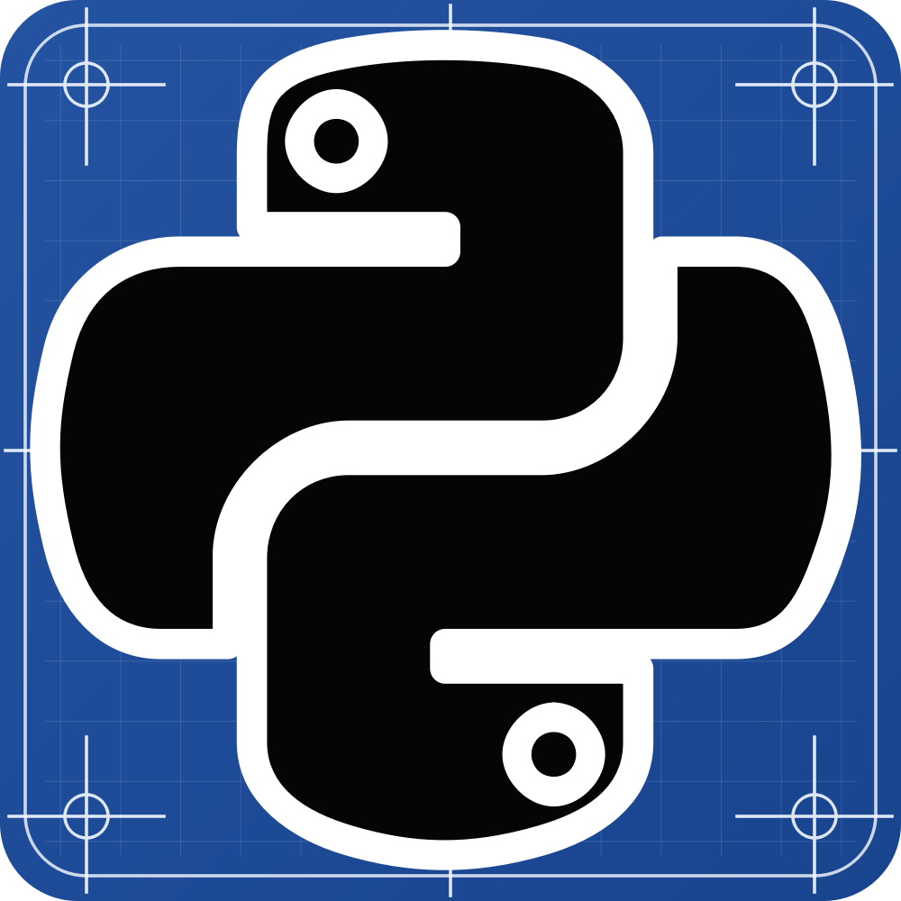
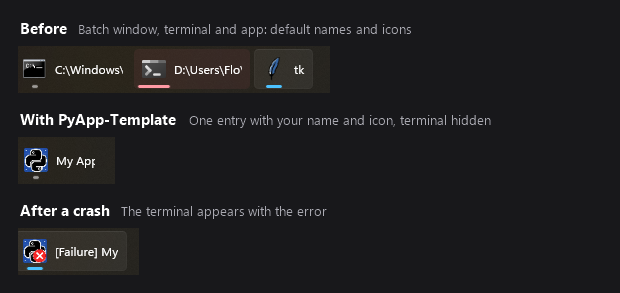

<div align="center">



# PyApp-Template

**Turn a Python script or GUI into a Windows app that people start from a shortcut.**

No Python to install, no virtual environment to activate, no terminal commands.


</div>

You write `main.py` and list your packages. The template uses [uv](https://docs.astral.sh/uv/) to provide the right Python and the exact package versions, and creates shortcuts with your app's name and icon. It also handles what a script usually lacks: log files, readable crash reports, a Stop button and a clean way to hand the app to someone else.

## Why not just run the file, or compile it?

| | Running `python main.py` | Compiling to an `.exe` | PyApp-Template |
| --- | --- | --- | --- |
| **Python on each PC** | You install it | Not needed | Not needed, provided automatically |
| **Same package versions everywhere** | Only if you manage it yourself | Yes, bundled at build time | Yes, locked with hashes |
| **After changing your code** | Run it again | Rebuild and redistribute | Restart it |
| **Build step** | None | Needed, and hidden imports or data files may need configuring | None |
| **Starting the app** | Terminal command or a `.py` file | Its `.exe` | Shortcuts in the folder and Start Menu |
| **Own name, icon and taskbar group** | No | Name and icon | Yes, for every copy of the app |
| **Hiding the terminal** | With `pythonw`, prints and errors are lost | Windowed builds lose prints and show errors in a basic dialog at best | Prints go to the log, and a terminal appears if the app fails |
| **Log files** | You write them | You write them | One per run, with timestamps |
| **When it crashes** | The window may close and take the error with it | The window closes, or you get a basic error dialog | The window stays open, and you get a readable report and a crash log |
| **Missing package** | `ModuleNotFoundError` | Runtime error, then rebuild | A menu offers to add it and restart |
| **Started twice** | Runs twice | Runs twice | You choose: allow, focus, prevent, replace or ask |
| **Stopping it safely** | Ctrl+C or close it, child processes may survive | Close it, child processes may survive | Stop shortcut asks it to close, then ends the whole process tree |

The launcher is readable Python, batch and PowerShell that uses only the standard library, so your packages can't break it. [Every file is documented](code/pyapp/DONT_CHANGE/README.md).

**Compile instead** if you need a single file or don't want to ship readable source code. PyApp-Template ships as a folder containing your source. It runs on Windows only, and the first setup needs internet unless you [make the folder portable](#shipping-your-app).

## Made for GUI apps

### Hide the terminal without losing your errors

GUI apps usually hide the terminal, because an extra black window doesn't belong next to a finished app. The catch is that debugging gets hard: prints go nowhere, and when the app crashes its window simply disappears without an explanation.

The **(no Terminal)** shortcut gives you both. No terminal is shown while the app runs, and everything it prints still goes to the log file. If the app fails, a terminal opens with the full error and a crash log is written. By default that terminal stays open until you press Enter. If the app ends normally, no terminal appears at all.

### One clean entry on the taskbar

A script started from a batch file can fill the taskbar with separate entries for the batch window, the Python terminal and the app, all with default names and icons. PyApp-Template shows one entry with your app's name and icon. Its windows share a taskbar identity, so they group with the shortcut that started them, including one you pinned.

<p align="center">
  
</p>

## Quick start

**You need:** Windows x64 and an internet connection for the first setup. Python is not required.

1. Clone or download this repository. Windows may warn you about downloaded scripts ([see below](#troubleshooting)).
2. Optional: set `program_name` and `python_version` in `code/pyapp/developer_settings.py`.
3. Run **`Setup - run first and after moving folder.cmd`**.
4. Start the example app with the new **PyApp-Template** shortcut (named after `program_name`).
5. Replace `code/main.py` with your own code.

Setup creates the shortcuts in the project folder and the Start Menu. **Run it again whenever you move or rename the folder**, then pin the new shortcut if you had pinned the old one. The Python environment adapts to a new location by itself.

## Building your app

You normally edit only three files:

| File | Purpose |
| --- | --- |
| `code/main.py` | Your application |
| `code/pyapp/developer_settings.py` | Name, Python version, packages, logging and behavior. The file is sorted from important to rarely needed, and every setting is explained in it. |
| `code/settings.py` | Optional settings for the people using your app. Read them with `import settings`; the Settings shortcut opens this file. |

### Adding packages

List them in `developer_settings.py`. The next start installs them:

```python
packages = ["requests", "numpy>=2", "pillow==11.*"]
```

You can also paste a `requirements.txt` as a triple-quoted string. Other ways to add packages:

- `code/pyapp/dev_tools/add_packages.cmd` adds packages by name.
- `find_imports.cmd`, in the same folder, scans existing code offline, lets you review what it found and adds the missing packages.
- Just start the app. A missing import offers to add the package and restart.

A package you remove from the list stays installed until you run `sync_packages.cmd`.

### Using a different Python

```python
python_version = "3.14"     # newest 3.14.x
python_version = "3.14.6"   # exactly this version
python_version = "3.14t"    # free-threaded build
python_version = ""         # newest stable, chosen once and then kept
```

Anything uv understands works, such as `"pypy@3.11"`. On Windows x64 that currently means CPython 3.8.2 and newer.

Changing this later is safe. A menu lets you keep your package versions, upgrade them or undo the change. The new environment is built next to the old one and replaces it only once it works.

### Changing the icons

Replace `code/pyapp/icons/icon.png`, run `regenerate icons.cmd` in that folder, then run Setup again. All shortcut and status icons are generated from that one image.

### Connecting your app to the launcher

The launcher passes these environment variables to your app:

| Variable | Value |
| --- | --- |
| `PROGRAM_NAME` | The `program_name` setting |
| `ICON_PATH` | Path of the app's `.ico` file |
| `PROGRAM_HAS_TERMINAL` | `1` if started with a terminal, otherwise `0` |
| `LOG_PATH` | This run's log file, empty if logging is off |
| `APP_ID` | The app's Windows taskbar identity |
| `WDIR_IS_SCRIPT_DIR` | `1` if the working folder is the script's folder, otherwise `0` |
| `CLOSE_AFTER_SUCCESS`, `CLOSE_AFTER_FAILURE` | `1` if the window closes right after that outcome, otherwise `0` |

Use `os.environ.get` so your code also runs with plain `python main.py`:

```python
import os

app_name = os.environ.get("PROGRAM_NAME", "My App")
icon_path = os.environ.get("ICON_PATH")  # None when started without the launcher
```

The taskbar grouping is already set up for you. To pass your own values, use `args_for_main_py` and `environment_for_main_py`.

## Shipping your app

**With Git or a download.** Commit these generated files along with your code, then have the recipient run Setup. It installs the locked package versions and a Python matching the recorded version request. Set an exact `python_version` (e.g. `3.14.2`) if the patch version must match too.

- `code/pyapp/generated/uv.lock`
- `code/pyapp/generated/.python-version`
- `code/pyapp/generated/auto_generated_icons.json`

**As a self-contained folder.** Run `code/pyapp/dev_tools/make_self_contained.cmd` and accept the settings it shows. Copy the whole folder to the other PC, e.g. as a zip: a Git clone is not enough, because Git ignores the local uv, Python and packages. Run Setup there once to create the shortcuts. Nothing is downloaded or installed, and the environment re-links itself to the copied Python. `status.cmd` shows whether a project is self-contained. The folder now contains Python and third-party packages, so [their licenses apply too](LICENSE.md).

Before you publish your app, replace the license placeholder in [`LICENSE.md`](LICENSE.md).

## What you get after Setup

| Shortcut | What it does |
| --- | --- |
| **&lt;name&gt;** | Starts the app with a terminal window |
| **&lt;name&gt; (no Terminal)** | Starts the app without one, for GUI apps |
| **Stop &lt;name&gt;** | Stops every running instance of this copy |
| **&lt;name&gt; - Settings** | Opens `code/settings.py` |
| **&lt;name&gt; - Edit Code** | Opens `main.py` in VS Code, or Notepad if VS Code isn't installed |
| **&lt;name&gt; - Logs** / **Crash Logs** | Opens the matching folder |

Set a shortcut's name to `None` in the settings to remove it. To add shortcuts to the desktop, use `desktop_shortcuts`, for example `["no_terminal"]`. Every copy of the project has its own taskbar group, so two apps made from this template never mix their windows.

## Common settings

All of these are in `developer_settings.py`. Mistakes are reported with the setting name or line number when you start the app.

| Setting | Controls |
| --- | --- |
| `instance_policy` | What happens if the app is started twice: `"allow"`, `"focus"`, `"prevent"`, `"replace"` or `"ask"` |
| `close_after_success`, `close_after_failure` | Whether the window closes or waits for Enter |
| `open_crash_log_after_failure`, `play_sound_after_failure` | What happens after an error |
| `use_classic_terminal` | Classic console, or Windows Terminal with tabs |
| `print_prepend`, `input_prepend` | Timestamps or other text before each line |
| `log_path`, `crash_log_path` | Log file locations; both accept date codes |
| `stop_timeout_seconds` | How long the app gets to close before it is terminated |
| `main_script_path` | Which file to run, if it isn't `main.py` |

<details>
<summary><b>Choosing where uv, Python and the packages live</b></summary>

| Setting | Options |
| --- | --- |
| `python_source` | `"uv_user"` (per-user folder shared by projects), `"local"` (inside this project, portable) or `"system"` (a Python already on this PC, e.g. from IT; nothing is downloaded) |
| `uv_prefer` | `"global"` or `"local"`: which uv to use when both exist |
| `uv_install_if_missing` | `"global"` (for your Windows user, added to your user PATH), `"local"` (downloaded into the project and checked against its published SHA-256) or `"never"` |
| `uv_version` | `""` (latest), an exact version such as `"0.11.32"`, or a range such as `">=0.9,<1"` |
| `uv_user_python_visible_globally` | For `"uv_user"`: register the Python with the `py` launcher and put it on PATH |
| `uv_cache` | `"global"` (per-user cache) or `"local"` (inside the project) |
| `use_system_certificates` | Use the Windows certificate store, which some company proxies require |

Settings marked `[bootstrap]` are read before any Python exists, so keep them on one line as plain values.

</details>

## Logs and crash reports

- **Normal log:** a UTF-8 file with your prints and inputs, with optional timestamps, and the output of native code and child processes.
- **`.output.log`:** the raw output of native code and child processes next to it, including the last moments before a hard crash. Kept only when the app does not end normally.
- **Crash log:** the error report, written after every failure and Ctrl+C.

Errors are reported however they happen, including unhandled exceptions, `sys.exit(1)`, errors in worker threads, and hard interpreter crashes. Exception chains, notes and exception groups are all shown, with the launcher's own frames removed.

Logging turns stdout and stderr into pipes. If your app needs a real console, set `enable_log_for_terminal_start = False`.

## Dev tools

Double-click any tool in `code/pyapp/dev_tools`, or use **`Dev Menu.cmd`** to reach them all.

| Tool | Purpose |
| --- | --- |
| `add_packages` / `remove_packages` | Add or remove packages and record the change in `packages` |
| `upgrade_packages` | Upgrade all or named packages within their limits |
| `sync_packages` | Make the environment match `uv.lock` exactly |
| `find_imports` | Find the packages your code imports and add the missing ones |
| `package_terminal` | Open a command prompt with the environment active and uv on PATH |
| `change_python` / `update_python` | Switch Python version, or update to the newest patch |
| `make_self_contained` | Put uv, Python and packages into this folder, so it runs offline on other PCs |
| `export_requirements` | Write a pinned `requirements.txt` from `uv.lock` |
| `status` | Show the state of uv, Python, the environment, the lock file and the shortcuts |
| `clean` | Delete logs, crash logs or per-run diagnostics |
| `remove_shortcuts` | Remove every shortcut Setup created |

See the [dev tools guide](code/pyapp/dev_tools/README.md) for details and typical workflows.

## What it changes on your PC

Everything stays in the project folder, with these exceptions under the default settings:

- If no uv is found, uv is installed for your Windows user and added to your user PATH.
- Python is installed in uv's per-user folder, registered with the `py` launcher and put on PATH.
- uv keeps a per-user download cache.
- If your uv can't provide the requested Python, a newer uv is placed in `%LOCALAPPDATA%\PyApp-Template\uv`. It is not added to PATH.
- A Start Menu folder is created for the shortcuts.

To keep uv, Python and its cache inside the project, set `python_source`, `uv_prefer`, `uv_install_if_missing` and `uv_cache` to `"local"`. To skip the Start Menu folder, set `start_menu_shortcuts = False`.

## Troubleshooting

Start with `code/pyapp/dev_tools/status.cmd`. It shows the current state and any errors the launcher ignored on purpose.

| Problem | Solution |
| --- | --- |
| Windows warns before running a downloaded `.cmd` | SmartScreen can flag downloaded scripts. Choose **More info**, then **Run anyway**, if you trust the source. |
| Shortcuts stopped working or show a warning | The folder moved, or a path setting changed. Run Setup again. |
| A package or Python change fails | Close all running instances first, because Windows locks files that are in use. |
| Installing a package fails with long-path errors | Windows limits path length, so move the project to a shorter path such as `C:\Apps\MyApp`. |
| Downloads fail on a company network | Set `use_system_certificates = True`. |
| `input()` or a console library misbehaves | Set `enable_log_for_terminal_start = False` to give the app a real console. |
| The environment seems broken | Delete `code/pyapp/generated/.venv`. The next start rebuilds it. |

## How it works

```text
shortcut
 └─ B\W.bat or B\N.bat
     └─ bootstrap\ensure_runtime.bat     uses cached uv and Python paths when still valid
         └─ resolve_runtime.bat and .py  only when needed: finds or installs uv and Python
     └─ actions\start_program.py         checks settings and instance policy, syncs .venv with uv.lock
         └─ runtime\bg_watchdog.py       owns the run: window, log, process group
             ├─ runtime\script_wrapper.py  ──▶  code\main.py
             └─ runtime\process_exit.py        sounds, crash log, recovery menu
```

`pyproject.toml` is generated from `developer_settings.py`, so the settings file stays the one place to edit. If you run `uv add` in the package terminal, the change is copied back into `packages`. If both changed, `developer_settings.py` wins.

The [launcher documentation](code/pyapp/DONT_CHANGE/README.md) covers each step and every file.

```text
.
├── Setup - run first and after moving folder.cmd
├── code/
│   ├── main.py                     ◀ your app
│   ├── settings.py                 ◀ optional settings for your users
│   └── pyapp/
│       ├── developer_settings.py   ◀ app, Python and package settings
│       ├── dev_tools/              package and Python tools
│       ├── icons/                  icon source and generator
│       ├── generated/              lock file, .venv, local uv and Python (created by the launcher)
│       └── DONT_CHANGE/            launcher internals
├── logs/
└── crash logs/
```

## Updating the template

Replace `code/pyapp/DONT_CHANGE` with the newer version. Your code and settings are outside that folder, and any new settings use their defaults until you add them. A major version may need extra steps, which are listed in [`CHANGELOG.md`](code/pyapp/DONT_CHANGE/CHANGELOG.md).

## License

The launcher in `code/pyapp/DONT_CHANGE` is available under `MIT OR Apache-2.0`. uv, Python and third-party packages keep their own licenses. Your project's own license goes in [`LICENSE.md`](LICENSE.md), which explains which terms cover which files.

Originally built by [Florian Lindinger](https://github.com/FlorianLindinger/PyApp-Template).
